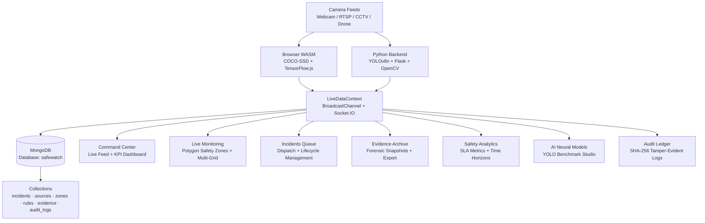

<div align="center">


# 🛡️ SafeWatch — Enterprise AI Security Operations Center

### *Real-Time AI Vision Surveillance · Polygon Safety Zone Defense · Forensic Evidence System*

[](https://nextwave-x-openai-swf.onrender.com)
[](https://reactjs.org/)
[](https://www.typescriptlang.org/)
[](https://python.org/)
[](https://www.mongodb.com/)
[](https://docs.ultralytics.com/)
[](LICENSE)

---

> **🏆 Built for HackITx MRDU Hackathon** — An end-to-end enterprise-grade AI Security Operations Center with real-time vision inference, smart zone intrusion detection, and live forensic evidence capture.

</div>

---

## 🌐 Live Demo

| Service | URL |
|---|---|
| **🖥️ Full Platform** | [https://nextwave-x-openai-swf.onrender.com](https://nextwave-x-openai-swf.onrender.com) |
| **📡 Backend API** | [https://nextwave-x-openai-swf.onrender.com/health](https://nextwave-x-openai-swf.onrender.com/health) |
| **⚡ API Status** | [https://nextwave-x-openai-swf.onrender.com/api/db/status](https://nextwave-x-openai-swf.onrender.com/api/db/status) |

> **Demo Login:** Use any credentials on the login screen to enter the platform.

---

## 📸 Platform Preview

| Command Center | Live Monitoring | Incident Queue |
|:---:|:---:|:---:|
| Real-time camera feeds with AI detections | Polygon safety zone draw tool | Filterable incident dispatch queue |
| **Evidence Archive** | **Safety Analytics** | **AI Neural Models** |
| Forensic snapshot HD viewer | Multi-horizon SLA analytics | YOLO benchmark & threshold studio |

---

## 🎯 What Is SafeWatch?

**SafeWatch** is a next-generation, full-stack **Security Operations Center (SOC)** platform purpose-built for mission-critical environments — industrial facilities, corporate campuses, perimeter defense, and smart city infrastructure.

It combines **browser-side WebAssembly AI inference (COCO-SSD / TensorFlow.js)**, **server-side YOLOv8 computer vision**, **interactive polygon safety zone drawing with ray-casting intrusion detection**, and **real-time MongoDB persistence** into one cohesive, operator-ready dashboard.

### ✨ Why SafeWatch Stands Out

| Feature | Description |
|---|---|
| 🧠 **Dual AI Engine** | Browser-side COCO-SSD (zero-latency) + Python YOLOv8n server inference running in parallel |
| 🔺 **Polygon Zones** | Draw custom multi-point safety zones on live camera feeds; ray-casting detects intrusions instantly |
| 🎥 **Multi-Grid Monitor** | Switch between 1×1, 2×2, and 3×3 camera grid layouts in real time |
| 🔴 **Live Incident Dispatch** | Automatic AI-triggered + manual operator incident creation with status lifecycle |
| 🔒 **SHA-256 Audit Ledger** | Tamper-evident, cryptographically chained audit log — SOC-2 Type II ready |
| 📸 **Forensic Evidence** | One-click HD snapshot capture with JSON dossier export and bulk downloader |
| 🌐 **WebSocket Real-time** | Socket.IO pushes detection data, metrics, incidents, and audit events to all connected operators |
| 🗄️ **MongoDB Persistence** | All data (incidents, sources, zones, audit logs) persisted to MongoDB with in-memory fallback |

---

## 🏛️ System Architecture



---

## 🗂️ Project Structure

```
SafeWatch/
├── 📁 src/
│   ├── 📁 components/              # Reusable React UI components
│   │   ├── CameraFeed.tsx          # WebRTC + AI detection canvas overlay
│   │   ├── FacilityBlueprintMap.tsx # 2D spatial floor plan radar
│   │   ├── AlertPanel.tsx          # Live alert notification panel
│   │   ├── AIOCRScannerModal.tsx   # AI-powered OCR document scanner
│   │   ├── EmergencyLockdownModal.tsx # Emergency lockdown controls
│   │   ├── ForensicVideoPlayerModal.tsx # Evidence video playback
│   │   ├── SOCShiftHandoverModal.tsx # Operator shift change system
│   │   ├── PTZVirtualJoystick.tsx  # PTZ camera virtual joystick
│   │   ├── AudioVoiceAnnouncer.tsx # Web Audio API siren + voice alerts
│   │   └── 📁 layout/             # AppShell, Sidebar, Header
│   ├── 📁 pages/                   # Route-level page components
│   │   ├── CommandCenter.tsx       # / — Main SOC dashboard
│   │   ├── LiveMonitoring.tsx      # /monitoring — Camera grid + polygon zones
│   │   ├── Incidents.tsx           # /incidents — Incident queue
│   │   ├── IncidentDetail.tsx      # /incidents/:id — Dossier + actions
│   │   ├── Evidence.tsx            # /evidence — Forensic snapshot archive
│   │   ├── Zones.tsx               # /zones — Safety zone manager
│   │   ├── Rules.tsx               # /rules — Alert rule builder
│   │   ├── Sources.tsx             # /sources — Camera source lifecycle
│   │   ├── Analytics.tsx           # /analytics — SLA + time-horizon charts
│   │   ├── AIModels.tsx            # /ai-models — YOLO benchmark studio
│   │   ├── AuditLogs.tsx           # /audit-logs — SHA-256 tamper-evident ledger
│   │   ├── SuspectTracking.tsx     # /tracking — Person re-identification
│   │   ├── Settings.tsx            # /settings — MongoDB + webhook config
│   │   └── Login.tsx               # /login — Auth portal
│   ├── 📁 contexts/
│   │   ├── LiveDataContext.tsx      # Global Socket.IO + AI state
│   │   └── AuthContext.tsx         # Auth session management
│   ├── 📁 hooks/                   # Custom React hooks
│   ├── 📁 utils/                   # Helper utilities
│   └── 📁 integrations/            # Third-party service connectors
├── 📁 database/
│   └── 001_mongodb_init.py         # MongoDB collection + index seeder
├── 📁 pipelines/                   # AI inference pipeline configs
├── 📁 docs/                        # Extended documentation
├── 📁 public/                      # Static assets
├── backend.py                      # Flask + Socket.IO + YOLOv8 + MongoDB
├── backend_requirements.txt        # Python dependencies
├── render.yaml                     # Render.com deployment config
├── vercel.json                     # Vercel SPA routing config
├── .env.example                    # Environment variable template
├── package.json                    # Node.js dependencies
├── vite.config.ts                  # Vite build configuration
└── tailwind.config.ts              # Tailwind design tokens
```

---

## 🌟 Platform Modules

| Module | Route | Core Capabilities |
|---|---|---|
| **🖥️ Command Center** | `/` | Live camera feed, AI detection overlay, KPI widgets, active alert queue, operator presence tracking |
| **📡 Live Monitoring** | `/monitoring` | **Draw Safety Zone** canvas tool (polygon + ray-casting), **Multi-Grid** 1×1/2×2/3×3 layout, **Capture Evidence** button, Web Audio siren |
| **🚨 Incidents Queue** | `/incidents` | Filterable incident table, **Report Incident** manual dispatch modal, **Export CSV** downloader |
| **📋 Incident Dossier** | `/incidents/:id` | **Acknowledge / Escalate / Resolve** actions, operator investigation notes, printable PDF dossiers |
| **🗺️ Safety Zones** | `/zones` | Interactive 2D spatial floor plan radar, zone creator, camera assignments, status toggles |
| **⚙️ Safety Rules** | `/rules` | Custom trigger builder, severity ranking (Critical → Low), enable/disable switches |
| **📷 Camera Sources** | `/sources` | Camera lifecycle management, **Test Stream** handshake diagnostic, power toggles |
| **🔍 Evidence Archive** | `/evidence` | HD modal snapshot viewer, single-click download, JSON dossier export |
| **📊 Safety Analytics** | `/analytics` | Time horizons (24h / 7d / 30d / 90d), resolution SLA metrics, report export |
| **🤖 AI Neural Models** | `/ai-models` | YOLO deployment switcher, live benchmark simulator, confidence/IoU threshold sliders |
| **🔏 Audit Logs** | `/audit-logs` | SHA-256 tamper-evident SOC audit ledger, CSV export |
| **🧍 Suspect Tracking** | `/tracking` | Person re-identification, timeline builder, cross-camera movement tracking |
| **⚙️ SOC Settings** | `/settings` | MongoDB connection tester, **Export System Backup (.json)**, user management, Slack/Discord webhooks |

---

## 🚀 Getting Started

### Prerequisites

| Requirement | Version |
|---|---|
| Node.js | v18.0+ |
| Python | v3.10+ |
| MongoDB | Local (`mongodb://localhost:27017`) or Atlas URI |
| npm / bun | Latest |

---

### 1️⃣ Clone the Repository

```bash
git clone https://github.com/ALLENKISAIRAKESH/HackITxMRDU.git
cd HackITxMRDU
```

---

### 2️⃣ Configure Environment Variables

```bash
# Copy the environment template
cp .env.example .env
```

Edit `.env` and fill in your values:

```env
# MongoDB Connection
MONGODB_URI=mongodb://localhost:27017/safewatch

# Backend API URL (for frontend)
VITE_API_URL=http://localhost:5000

# Optional AI Keys
OPENAI_API_KEY=your_key_here
```

---

### 3️⃣ Frontend Setup

```bash
# Install Node.js dependencies
npm install

# Start the Vite development server
npm run dev
```

> 🌐 Opens at **`http://localhost:8081`**

---

### 4️⃣ Backend Setup

```bash
# Create and activate Python virtual environment
python -m venv .venv

# Windows
.\.venv\Scripts\activate

# macOS / Linux
source .venv/bin/activate

# Install Python dependencies
pip install -r backend_requirements.txt

# Start the backend server
python backend.py
```

> 🔧 API Server runs at **`http://localhost:5000`** with live MongoDB sync and WebSocket support.

---

### 5️⃣ Initialize MongoDB Collections

```bash
# Seed the database with initial schema and indexes
python database/001_mongodb_init.py
```

---

### 6️⃣ Production Build

```bash
# Build optimized frontend bundle
npm run build

# Preview the production build locally
npm run preview
```

---

## 📡 REST API Reference

### Base URL
```
Production: https://nextwave-x-openai-swf.onrender.com
Local:      http://localhost:5000
```

### Endpoints

| Method | Endpoint | Description |
|---|---|---|
| `GET` | `/health` | Service heartbeat + AI + DB status |
| `GET` | `/api/db/status` | MongoDB connection health + collections |
| `GET` | `/api/incidents` | List all safety incidents (MongoDB or in-memory) |
| `POST` | `/api/incidents` | Create a new security incident |
| `PATCH` | `/api/incidents/:id` | Update incident status (open/ack/escalated/resolved) |
| `GET` | `/api/sources` | List all configured camera sources |
| `GET` | `/api/audit-logs` | Retrieve tamper-evident audit ledger |
| `GET` | `/api/metrics` | Live system metrics (people count, risk level, active ops) |
| `GET` | `/stream?url=<RTSP_URL>` | MJPEG proxy stream with YOLOv8 detection overlay |

### WebSocket Events (Socket.IO)

| Event | Direction | Payload |
|---|---|---|
| `detection` | Server → Client | YOLOv8 bounding boxes + risk level per frame |
| `incident_created` | Server → Client | New incident object |
| `incidents_list` | Server → Client | Full incident array sync |
| `metrics_update` | Server → Client | Live KPI metrics |
| `audit_log` | Server → Client | New audit entry |
| `client_detection` | Client → Server | Browser COCO-SSD detection data |
| `user_presence` | Client → Server | Operator active session ping |
| `action_acknowledge_incident` | Client → Server | Acknowledge an open incident |
| `action_resolve_incident` | Client → Server | Resolve an incident |

---

## 🔒 Security & Compliance

| Standard | Implementation |
|---|---|
| **SOC-2 Type II Ready** | Cryptographic SHA-256 chaining on all MongoDB audit records |
| **RBAC** | Strict separation between `Admin` and `Operator` roles |
| **Edge Privacy** | Live video frames processed locally via WebAssembly / WebGL — no unauthorized external streaming |
| **Tamper-Evident Logs** | Audit ledger with hash chain prevents retroactive modification |
| **Encrypted Transport** | All production traffic via HTTPS / WSS |

---

## 🛠️ Technology Stack

### Frontend
| Technology | Purpose |
|---|---|
| React 18 + TypeScript | Component-based UI framework |
| Vite 5 | Ultra-fast build tooling + HMR |
| TailwindCSS + shadcn/ui | Design system + accessible components |
| TensorFlow.js + COCO-SSD | In-browser AI object detection |
| Socket.IO Client | Real-time WebSocket communication |
| React Router v6 | Client-side routing |
| Recharts | Data visualization |
| React Query | Server state management |

### Backend
| Technology | Purpose |
|---|---|
| Python 3.11+ | Server runtime |
| Flask + Flask-SocketIO | REST API + WebSocket server |
| Ultralytics YOLOv8n | Server-side computer vision |
| OpenCV | Video stream capture + processing |
| PyMongo | MongoDB driver with connection pooling |
| Flask-CORS | Cross-origin request handling |

### Infrastructure
| Technology | Purpose |
|---|---|
| MongoDB | Primary database (incidents, zones, audit logs) |
| Render.com | Full-stack cloud deployment |
| Vercel | Frontend CDN deployment option |

---

## ☁️ Deployment

### Deploy to Render (Recommended)

The project includes a ready-to-use [`render.yaml`](render.yaml) for one-click deployment:

1. Fork this repository
2. Connect your GitHub account to [Render.com](https://render.com)
3. Create a **New Blueprint** and select this repo
4. Render auto-detects `render.yaml` and deploys both frontend and backend

### Deploy Frontend to Vercel

```bash
# Install Vercel CLI
npm i -g vercel

# Deploy
vercel --prod
```

The [`vercel.json`](vercel.json) includes SPA rewrite rules for React Router.

---

## 🤝 Contributing

We welcome contributions from the community!

1. **Fork** the repository
2. **Create** a feature branch: `git checkout -b feature/your-feature-name`
3. **Commit** your changes: `git commit -m "feat: add your feature"`
4. **Push** to the branch: `git push origin feature/your-feature-name`
5. **Open** a Pull Request

### Commit Convention
```
feat:     New feature
fix:      Bug fix
docs:     Documentation only changes
style:    Formatting, missing semicolons, etc.
refactor: Code restructuring without feature change
perf:     Performance improvement
test:     Adding or updating tests
chore:    Build process or tooling changes
```

---

## 📄 License

This project is licensed under the **MIT License** — see the [LICENSE](LICENSE) file for details.

---

<div align="center">

**Built with ❤️ for HackITx MRDU Hackathon**

[🚀 Live Demo](https://nextwave-x-openai-swf.onrender.com) · [🐛 Report Bug](https://github.com/ALLENKISAIRAKESH/HackITxMRDU/issues) · [✨ Request Feature](https://github.com/ALLENKISAIRAKESH/HackITxMRDU/issues)


</div>
