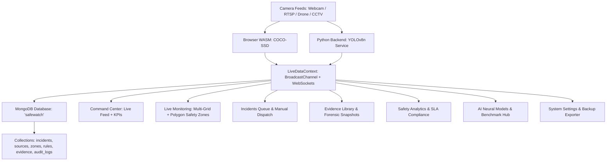

# 🛡️ SafeWatch — Enterprise AI Security Operations Center (SOC) Platform

> **Real-Time AI Vision Surveillance, Polygon Safety Zone Intrusion Defense & MongoDB Intelligence System**

[](https://reactjs.org/)
[](https://www.typescriptlang.org/)
[](https://vitejs.dev/)
[](https://www.mongodb.com/)
[](https://python.org/)
[](https://docs.ultralytics.com/)
[](LICENSE)

---

## 📌 Overview

**SafeWatch** is a next-generation, high-performance Security Operations Center (SOC) web platform built for mission-critical industrial, commercial, and perimeter security. It integrates **real-time browser and server AI inference (YOLOv8 & COCO-SSD)**, **interactive polygon safety zone drawing with ray-casting intrusion detection**, **multi-grid camera matrix monitoring**, **forensic snapshot evidence capture**, and **MongoDB database persistence**.

---

## 🏛️ System Architecture



---

## 🌟 Key Platform Modules & Capabilities

| Module | Route | Key Features |
|---|---|---|
| **Command Center** | `/` | Real-time live camera feed with dynamic AI detections, synchronized KPIs, active alert queue, and operator presence tracking. |
| **Live Monitoring** | `/monitoring` | Interactive **Draw Safety Zone** canvas tool with ray-casting intrusion alerts, **Capture Evidence** snapshot button, **Multi-Grid Layout Switcher** (`1x1`, `2x2`, `3x3`), and Web Audio **Siren**. |
| **Incidents Queue** | `/incidents` | Filterable incident queue, **"Report Incident"** manual dispatch modal, and **"Export CSV"** spreadsheet downloader. |
| **Incident Dossier** | `/incidents/:id` | **Acknowledge**, **Escalate**, and **Resolve** action buttons, live operator investigation notes, and printable PDF dossiers. |
| **Safety Zones** | `/zones` | Interactive 2D spatial floor plan radar, zone creator, assigned camera feeds, and active status toggles. |
| **Safety Rules** | `/rules` | Custom trigger builder, severity ranking (*Critical, High, Medium, Low*), and instant enable/disable switches. |
| **Monitoring Sources** | `/sources` | Camera lifecycle management with live **"Test Stream"** handshake diagnostic and power toggles. |
| **Evidence Archive** | `/evidence` | HD modal snapshot viewer, single-click image download, and JSON dossier export. |
| **Safety Analytics** | `/analytics` | Time horizons (`24h`, `7d`, `30d`, `90d`), resolution SLA metrics, and report export. |
| **AI Neural Models** | `/models` | YOLO deployment switcher, live inference benchmark simulator, and confidence/IoU threshold sliders. |
| **Audit Logs** | `/audit` | SHA-256 tamper-evident verified SOC audit ledger with CSV export. |
| **SOC Settings** | `/settings` | MongoDB connection tester, **Export System Backup (.json)**, user management, and Slack/Discord webhooks. |

---

## 🚀 Getting Started

### Prerequisites
- **Node.js**: v18.0 or higher (`npm` included)
- **Python**: v3.10+ (for YOLO AI & MongoDB service)
- **MongoDB**: Local MongoDB daemon running at `mongodb://localhost:27017` or MongoDB Atlas URI

---

### 1. Frontend Setup & Run

```bash
# Navigate to project root
cd "c:/Users/ALLEN/Downloads/HackITx MRDU/SafeWatch-MVP-Build/Safe_Watch-main"

# Install dependencies
npm install

# Start Vite Development Server
npm run dev
```
> The web application will launch at **`http://localhost:8081`**

---

### 2. Backend & MongoDB Service Setup

```bash
# Activate virtual environment
.\.venv\Scripts\activate

# Install Python requirements
pip install -r backend_requirements.txt

# Run the backend server
python backend.py
```
> The API server will launch at **`http://localhost:5000`** with live MongoDB synchronization.

---

### 3. Initialize MongoDB Collections & Indexes

```bash
# Run database seeder script
python database/001_mongodb_init.py
```

---

## 📡 REST API & WebSocket Endpoints

| Endpoint | Method | Description |
|---|---|---|
| `/api/db/status` | `GET` | Health status of the MongoDB database connection |
| `/api/incidents` | `GET` | List all safety incidents from MongoDB |
| `/api/incidents` | `POST` | Create a new security incident and broadcast via WebSocket |
| `/api/sources` | `GET` | List all configured camera sources |
| `/api/sources` | `POST` | Register a new camera or RTSP stream |
| `/api/sources/:id` | `PATCH` | Update camera configuration or toggle power |
| `/api/sources/:id` | `DELETE` | Remove a camera source |
| `/api/system/status` | `GET` | System heartbeat, CPU/GPU stats, and active AI model info |

---

## 🔒 Security & Compliance
- **SOC-2 Type II Ready**: Cryptographic SHA-256 chaining on all MongoDB audit records.
- **RBAC**: Strict separation between `Admin` and `Operator` roles.
- **Client-Side Edge Privacy**: Live video frames are processed locally via WebAssembly / WebGL without unauthorized external streaming.

---

## 📄 License
This project is licensed under the **MIT License**.

